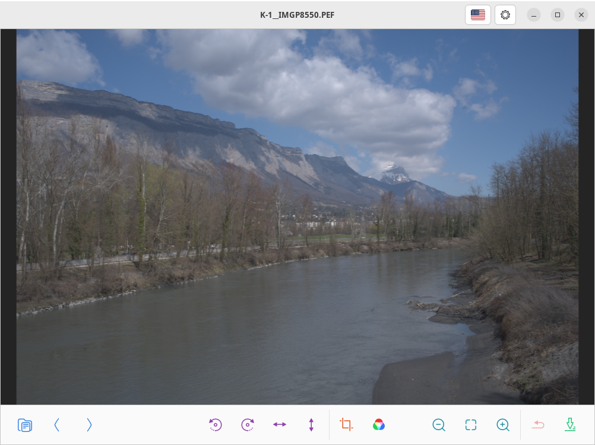

# Mirante

Mirante is an image viewer for Linux, built with GTK 3 and Rust, made
for Ubuntu, Debian and Linux Mint with non-destructive editing.

# Features

- Cropping, rotating, flipping or color-correcting without ever touching
the original file.

- Raw file format support

- Exporting

 Mirante remembers your edits for next time, and **Export…**
writes a new file whenever you want one.



## What it opens

PNG, JPEG, TIFF, BMP, Photoshop PSD, HEIC/HEIF and camera RAW files from Canon,
Nikon, Sony, Fujifilm, Olympus, Panasonic and Pentax, plus DNG. Every decoder is
written from scratch in Rust, and each format is a plugin you can add or remove
in **Settings**.

Colours are managed from start to finish: embedded profiles are honoured, and the
picture is shown through your monitor's profile, a standard preset or an ICC
file of your own.


## Install

Build the package and install it:

```bash
sudo apt install libgtk-3-dev dpkg-dev
./build.sh
sudo apt install ./dist/mirante_*_amd64.deb
```

Building needs Rust 1.85 or newer from [rustup](https://rustup.rs). Installing
makes Mirante your default image viewer; removing it gives that role back.

## Learn more

- [ARCHITECTURE.md](ARCHITECTURE.md): how Mirante is put together.
- [STYLE_GUIDE.md](STYLE_GUIDE.md): how to contribute code.

## License

Mirante is free software under the [GNU GPL, version 3 or later](LICENSE).

It includes code ported from dcraw by Dave Coffin and, for Canon CR3, from
LibRaw. Camera colour matrices come from dcraw, and the flag icons come from
flag-icons (MIT, see `assets/flags/COPYING.flag-icons`).
